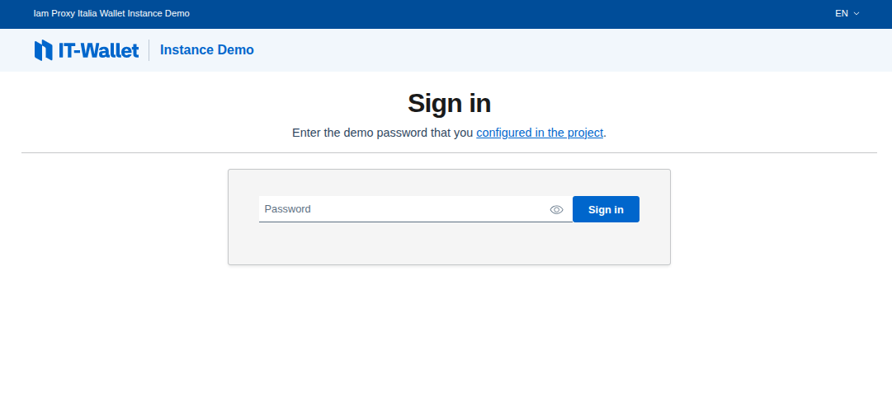
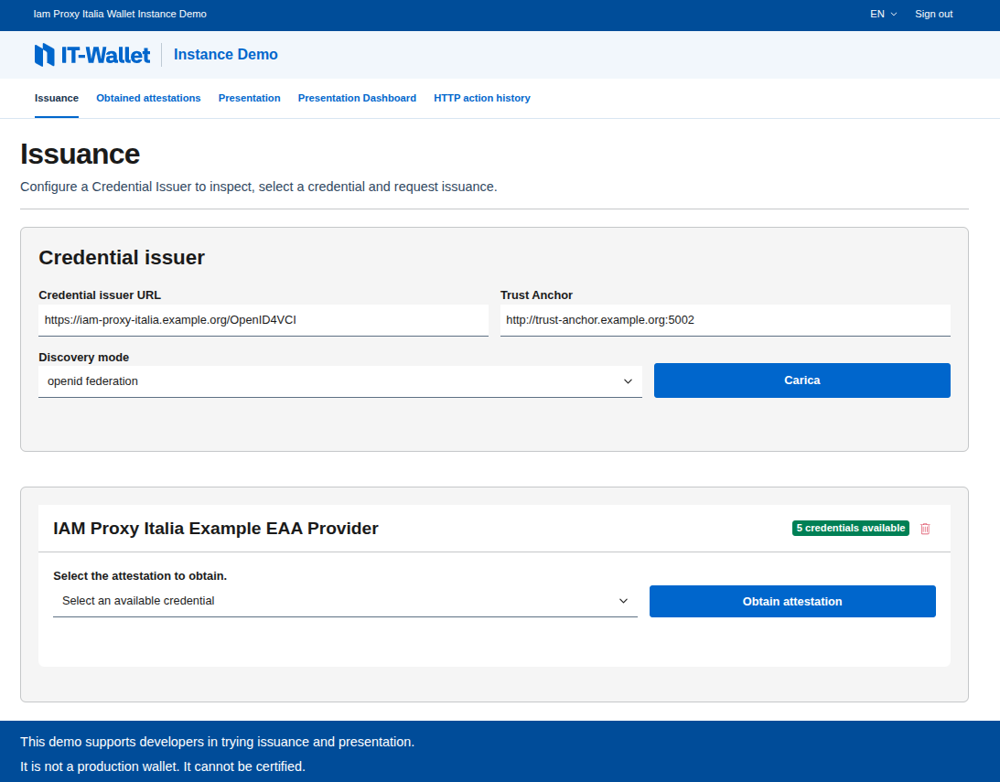
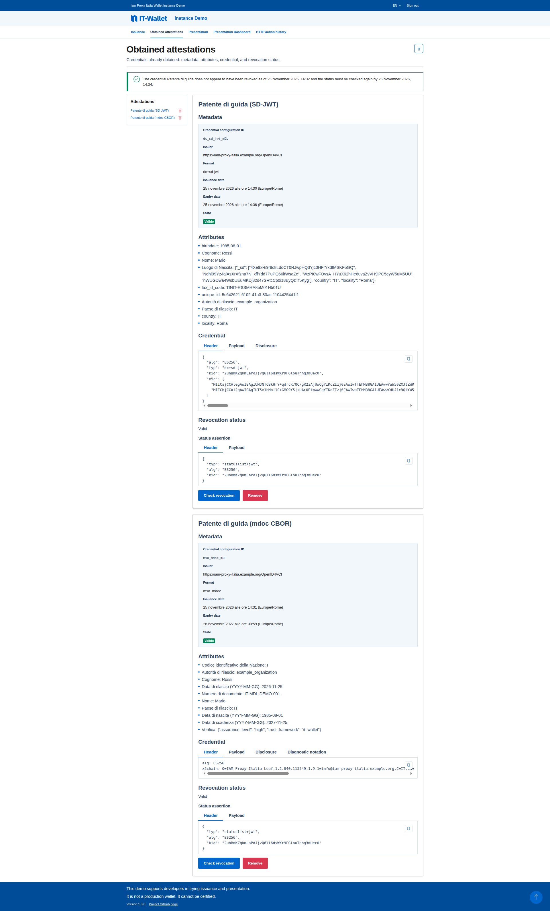
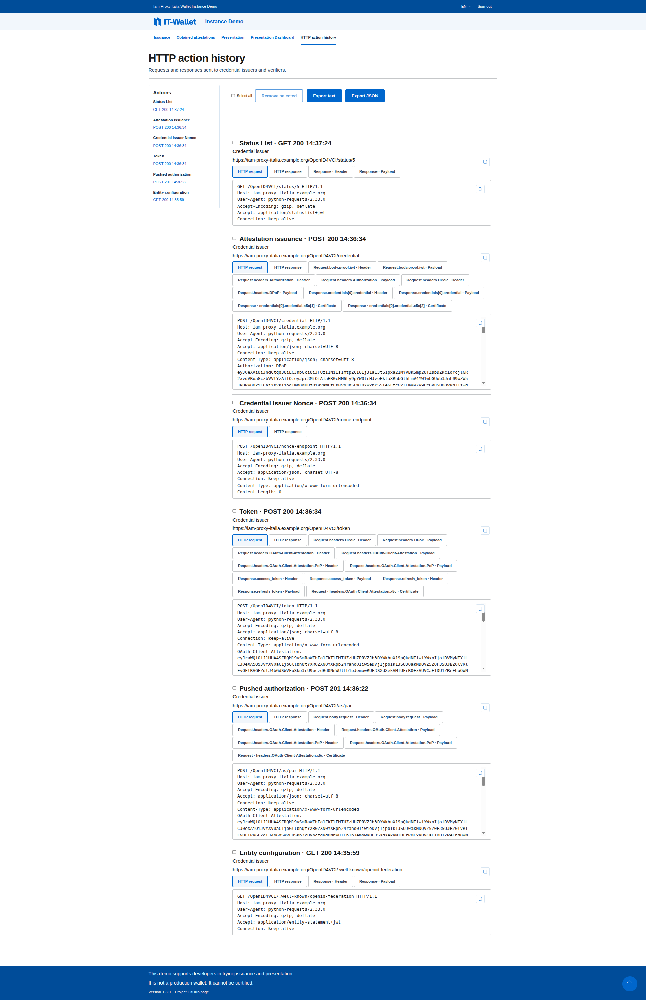
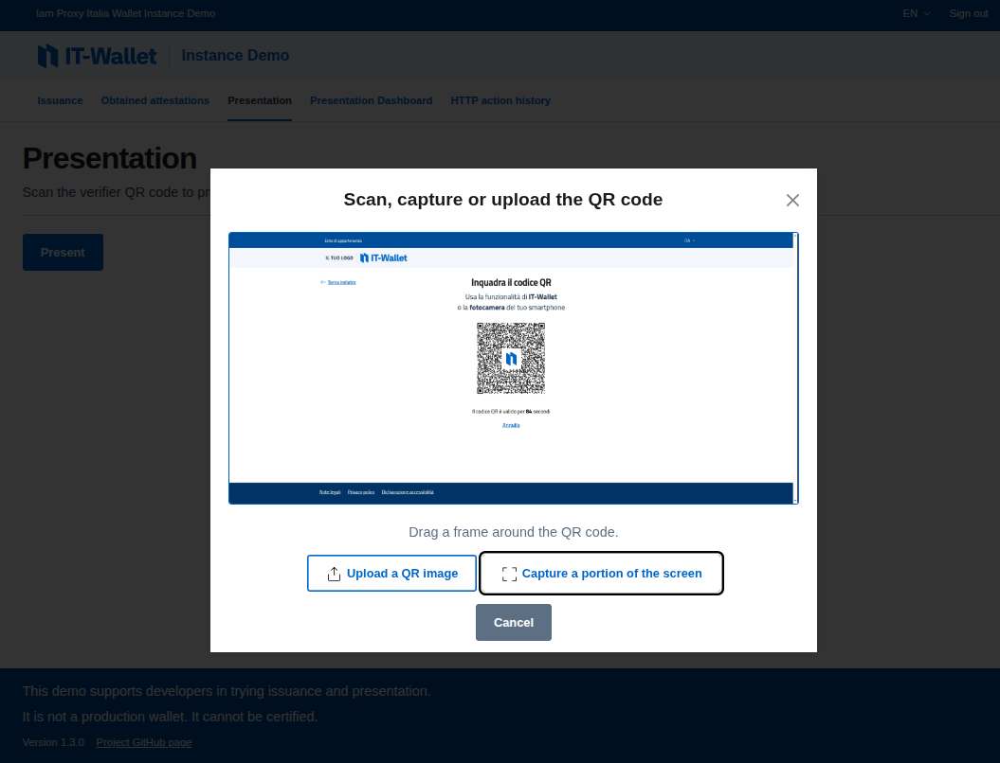
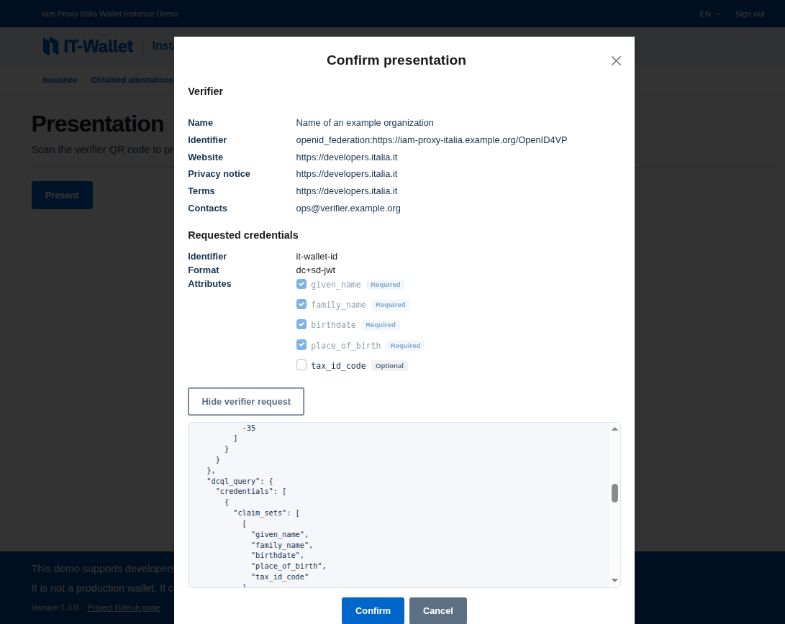
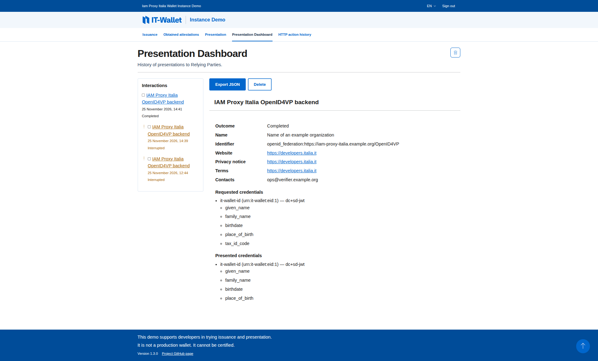

# Funzionalità

Screenshot delle funzionalità principali della demo. Ogni immagine ha una didascalia.

## 1. Accesso

*Accesso alla demo con la password configurata nel progetto (`WALLET_INSTANCE_PASSWORD`).*

## 2. Discovery del Credential Issuer e richiesta di emissione

*Configurazione di un Credential Issuer da ispezionare (URL, Trust Anchor, modalità di discovery) e richiesta di emissione di un attestato dal catalogo caricato.*

## 3. Attestati ottenuti

*Attestati già ottenuti: metadata, attributi dell’utente, attestato in chiaro (Header, Payload, Disclosure o notazione diagnostica CBOR) e stato di revoca, per formati SD-JWT e mdoc CBOR.*

## 4. Storico Azioni HTTP e ispezione degli oggetti

*Registro delle richieste e risposte verso credential issuer, verificatori e federazione, con ispezione del messaggio HTTP e dei JWT incorporati (header e payload).*

## 5. Presentazione cross-device

*Avvio della presentazione OpenID4VP acquisendo il QR del Relying Party: caricamento di un’immagine o cattura di una porzione di schermo.*

## 6. Gestione della richiesta di presentazione e selective disclosure

*Conferma della presentazione: metadata del verificatore, attributi richiesti con selective disclosure e ispezione della richiesta del verificatore (query DCQL).*

## 7. Dashboard Presentazioni

*Storico delle interazioni con i Relying Party: esito, metadata del verificatore, attestati richiesti e presentati, esportazione JSON.*
